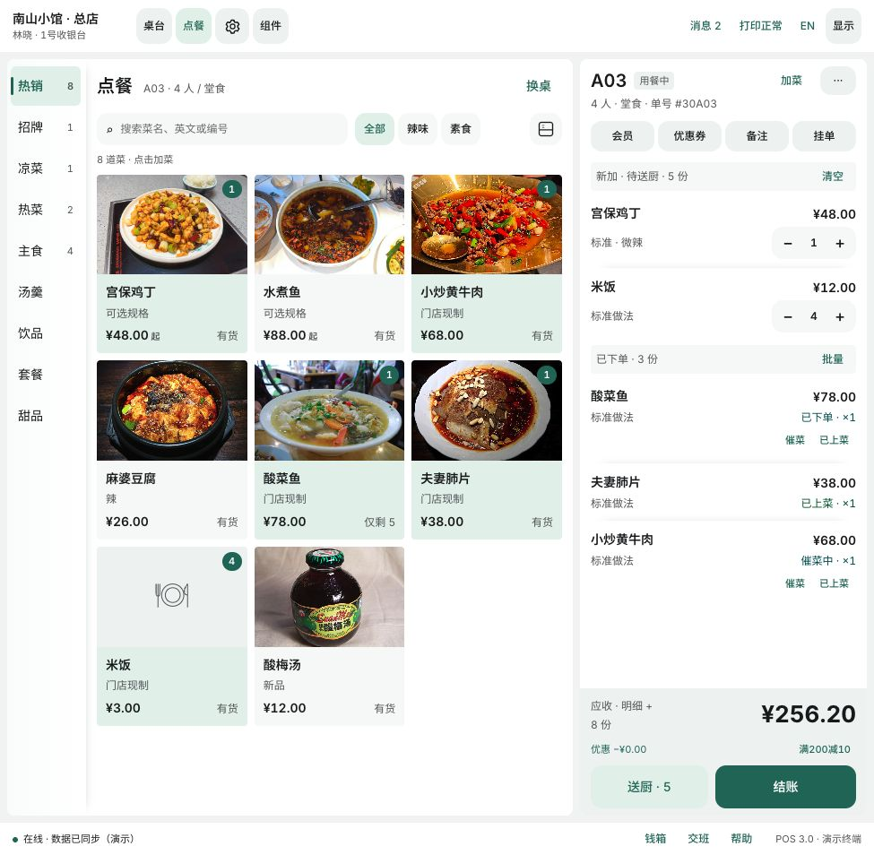
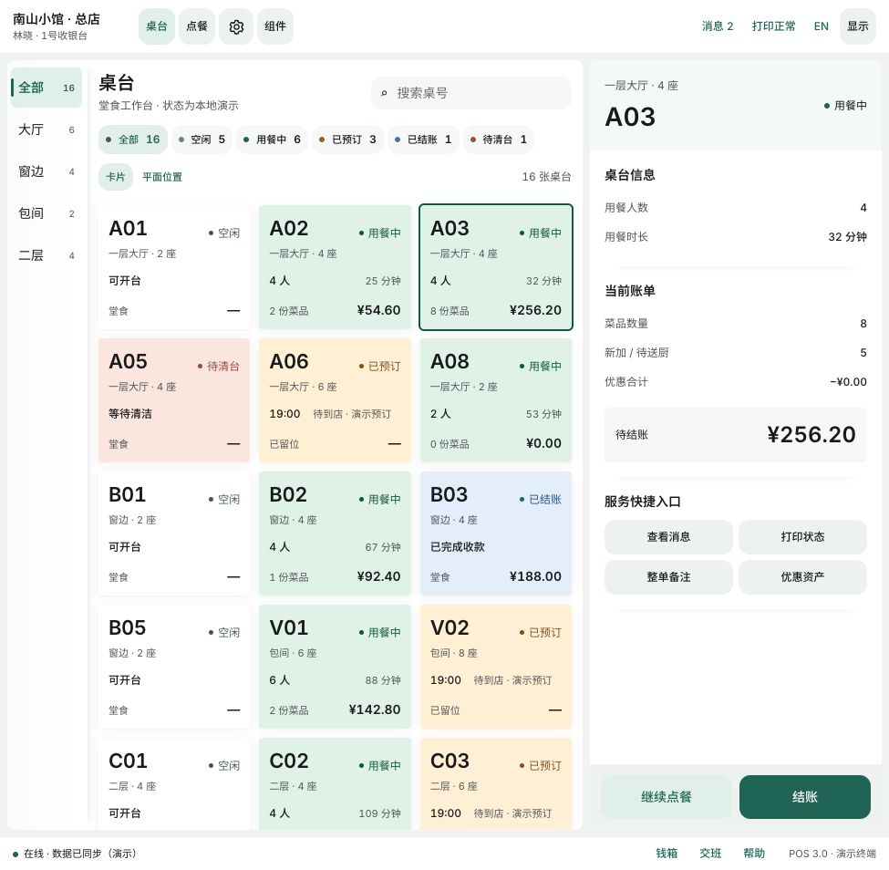
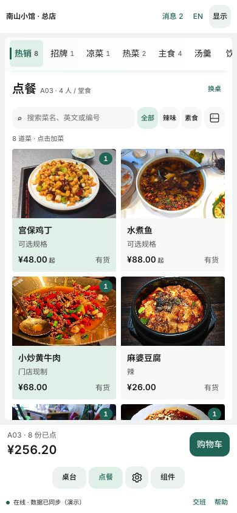

# Android 页面实施与验收清单

基线：2026-11-03，原型v3.6。按“公共基础→页面闭环→管理补齐→真实服务”推进。表中为待实施/核验项，不表示已有Android全部完成。

## 1 公共基础

| 任务 | 完成条件 |
| --- | --- |
| 主题与字体 | 八套皮肤、六种字体方案、独立容器/按钮圆角、三档密度/字号；中文回退、等宽金额；默认与当前原型一致 |
| 基础组件 | 按钮主/次/危险/禁用/加载/焦点、图标、输入错误、筛选、选择、步进器、标签、浮层；组件页直接复用 |
| 工作台壳 | 页头门店/员工/终端、消息、打印、语言、显示和齿轮管理入口；页脚在线/钱箱/交班/帮助 |
| 布局适配 | 宽屏双栏、窄屏摘要与抽屉；分类逻辑分隔，无宽缝；键盘出现时底部操作可达 |
| 数据作用域 | 认证、门店、订单、页面状态分离；切店不串单，返回不丢草稿；重启恢复策略明确 |

## 2 页面清单

| 页面/模块 | 应包含内容 | 关键验收 |
| --- | --- | --- |
| 登录/注册 | 账号、受保护凭据输入、校验、加载、错误、选店跳转 | 不保存/输出密码；真实账号服务另接；失效会话返回登录 |
| 选择门店 | 可访问门店、门店码/地址、选择态、加载失败 | 未授权店不可进入；切店隔离目录、桌台、订单与位置 |
| 桌台网格 | 区域栏、状态/搜索、五状态卡片、详情、开台/结账 | 整卡背景而非顶条；卡片不溢出；区域/状态/搜索组合生效 |
| 桌台平面 | 按区域展示位置、画布滚动、桌台选择、坐标调整 | 坐标范围与画布换算一致；越界拒绝；不能宣称支持拖拽 |
| 开台 | 桌台、座位、人数、确认及冲突反馈 | 人数1至座位数；成功进入同桌订单；重复提交幂等 |
| 点餐 | 分类、搜索、快捷筛选、单一排列切换、菜品网格、账单坞 | 有图/无图×左右/上下；搜索不挤占整行；保留选中与库存反馈 |
| 规格/SKU | 组合名称、独立价格、余量、备注 | 未选不能提交，沽清禁选，不同SKU独立计价和库存 |
| 购物车 | 新加、待送厨、已下单/催菜/上菜分组、加减、清空 | 清单空间优先；只改草稿；同组合合并；已送厨行保留 |
| 送厨 | 发送中、失败、离线队列、查询/重试 | 不重复出单；失败不丢行；队列重启恢复；状态不回退 |
| 结账 | 新加/已送厨、历史记录、优惠券/储值/活动、报价、渠道 | 结账主操作，送厨次操作；未送厨不进入支付核对；历史不重复计入 |
| 支付结果 | 处理中、成功、失败、未知结果、查询 | 超时先查单，不重复扣款；真实成功后再推进桌台状态 |
| 桌台/区域管理 | 新建、所属区域、桌号、座位、列表查看 | 门店内桌号唯一、座位整数；新增后工作台同步 |
| 商品分类/规格组 | 名称、多语言、选项、加价及校验 | 使用稳定id；重名/无效金额反馈；旧字符串结构需迁移 |
| 商品编辑 | 基本资料/分类、图片、售价、规格、库存、SKU表、餐牌 | 分区紧凑、底部保存可达；取消不落盘，错误不清空 |
| 图片 | 选择、预览、替换、移除、读取/上传状态 | ≤5MB且格式正确；异步旧回调不覆盖新图；失败可重试 |
| SKU矩阵 | 多组组合、独立售价/库存、汇总 | ≤100组合；基础价调整保留手动值；0库存及两位小数校验 |
| 库存盘点 | 各SKU数量、原因、汇总、冲突 | 非负整数、并发冲突不覆盖；库存服务日志可追踪 |
| 餐牌 | 商品关联、草稿/发布、空餐牌限制 | 未发布不可见；解绑不影响已有订单快照 |
| 门店/系统设置 | 门店信息、小票、费用、终端打印、员工权限入口 | 配置保存与业务生效范围明确；不把演示开关当设备接通 |
| 显示设置 | 外观/布局/文字；折叠形状微调、恢复默认 | 每项唯一，即时生效，订单不丢；旧偏好迁移兼容 |

## 3 必测场景

1. A桌草稿加菜→切B桌→返回A桌，行项目/备注/优惠不串；切门店同样隔离。
2. 两组各两选项生成4个SKU，手动改价及库存，修改基础价后手动值保留。
3. SKU只剩1份，加1份后继续增加被拒，其他SKU余量不受影响。
4. 取消商品编辑不修改原商品；保存错误留在表单，上传中不允许重复保存。
5. 送厨失败/断网→重启→恢复队列→重试，只产生一个批次；乱序回执不使served回退。
6. 报价变化、券失效、储值不足、支付超时结果未知时，清楚显示原因并保留账单。
7. 中文长菜名、英文长词、无图、有图、最大字号、键盘弹出、平板分屏时，金额和主操作不被遮挡。
8. 八套皮肤下选中态清晰，状态含文字；灰框和按钮底部阴影不重新出现。
9. 打印失败/缺纸/设备断连不冒充成功；补打不重复收款，钱箱操作受权限约束。
10. 从管理回到点餐，同一已发布餐牌的商品/SKU/图片一致；解除关联后商品隐藏，旧订单保持快照。

## 4 分阶段交付

- 页面原型阶段：演示Repository可跑通已确认页面；组件和错误/空状态可评审；无真实支付成功宣称。
- 业务接入阶段：真实身份/门店/目录/订单/库存契约、错误码、版本和幂等经过接口联调。
- 终端验收阶段：目标Android设备上的字体、触控、离线恢复、支付结果、打印钱箱、权限和稳定性通过。

目标设备尺寸、DPI、横竖屏策略、后端契约、支付/打印型号尚未在本轮锁定。它们影响真机验收与接入，不阻碍先按现有Compose骨架开展共享组件和演示页面开发。

## 5 视觉对照

以下为当前HTML原型截图，只用于布局/层级参考，不替代实时状态与Android真机验证。

