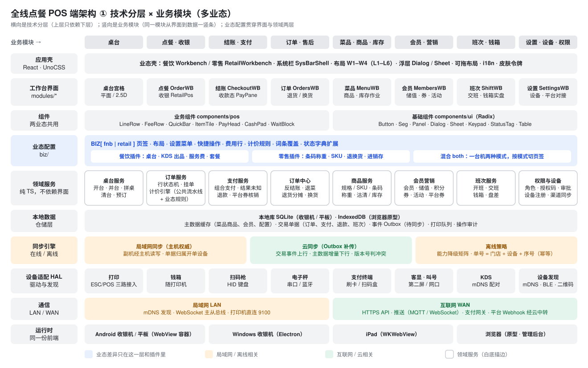
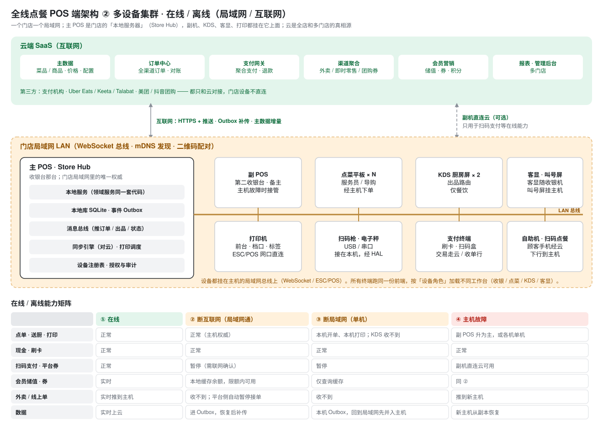

# 全线点餐 POS · 端架构（技术分层 · 业务模块 · 多业态 · 离线 · 多设备集群）

> 状态：方案稿 v1 · 2026-11-11
> 图由 `docs/tools/gen-arch.py` 生成（`cd docs && python3 tools/gen-arch.py "全线点餐POS-端架构"`），改图改脚本，不手改 SVG。
> 关联：《[零售 POS 设计方案](全线点餐POS-零售POS设计方案.md)》《[设备发现·外送平台·可拖布局·桌台2D3D方案](全线点餐POS-设备发现·外送平台·可拖布局·桌台2D3D方案.md)》《[React 迁移方案](全线点餐POS-React迁移方案.md)》

## 一、四个诉求和对应的架构手段

| 诉求 | 手段 | 落在哪一层 |
|---|---|---|
| 技术分层、业务分模块 | 横向 10 层，上层只依赖下层；竖向 8 个业务模块，每个模块从界面到领域服务一竖条，模块之间只通过领域服务的接口和事件交互 | 全部 |
| 多业态（餐饮 / 零售 / 混合） | 差异只放在「业态配置」一层 + 两个业态插件；壳、组件、领域服务、数据、同步、设备都只有一套 | 业态配置 `biz/` |
| 离线 / 在线（局域网 / 互联网） | 每台设备都有本地库和事件 Outbox；门店内主 POS 是局域网权威，云是全局权威；按网络状态做能力降级 | 本地数据 · 同步引擎 · 通信 |
| 多设备集群 | 主 POS 作 Store Hub（本地服务 + 消息总线）；副 POS、点菜平板、KDS、客显、打印挂在局域网总线上；设备按角色加载不同工作台；主机故障时副 POS 接管 | 同步引擎 · 设备适配 · 运行时 |

## 二、技术分层 × 业务模块

| 层 | 职责 | 现在原型里对应的代码 |
|---|---|---|
| 应用壳 | 业态分流、系统栏、W1–W4 布局、浮层、可拖布局、i18n、皮肤令牌 | `layout/workbench.tsx`（`Workbench` → 餐饮 / `retail/RetailWorkbench.tsx`）、`layout/modules.ts`、`components/pos/sysbar.tsx` |
| 工作台界面 | 每个业务模块一个工作台，只做展示和交互 | `modules/*`、`retail/RetailPos.tsx` |
| 组件 | 业务组件两业态共用；基础组件封装 Radix | `components/pos/*`、`components/ui/*` |
| 业态配置 | 页签、布局、设置菜单、快捷操作、费用行、计价规则、词条覆盖、状态字典扩展；餐饮 / 零售插件 | `biz/index.ts`、`biz/dict.ts`、`biz/store.ts` |
| 领域服务 | 业务规则：订单行状态机、计价引擎、支付、售后、商品、会员营销、班次、权限；纯 TS，不依赖界面，主机和副机跑同一份 | `domain/`（2026-11-11 抽出）：`pricing` 计价引擎 + `FNB_RULES` / `RETAIL_RULES` · `order` 餐饮订单行 · `cart` 零售购物车 · `payment` 支付 · `catalog` 商品码 · `table` 桌台；`npm run test:domain` 自测 |
| 本地数据 | 主数据缓存、交易单据、事件 Outbox、打印队列、审计 | 原型：zustand + localStorage；正式：SQLite（收银机）/ IndexedDB（浏览器） |
| 同步引擎 | 局域网同步（主机权威）、云同步（Outbox 补传、主数据增量）、离线策略 | 原型未实现 |
| 设备适配 HAL | 打印、钱箱、扫码枪、电子秤、支付终端、客显、KDS、设备发现 | 原型：`data/devices.ts` 模拟；方案见设备发现方案 §一 |
| 通信 | 局域网：mDNS、WebSocket 总线、打印直连；互联网：HTTPS、推送、支付网关、平台 Webhook 经云 | 原型未实现 |
| 运行时 | 同一份前端跑在 Android WebView、Electron、iPad、浏览器 | 原型：浏览器 |

**依赖规则**
1. 工作台界面不直接调设备或网络，只调领域服务；领域服务通过仓储读写本地库，由同步引擎决定何时上行。
2. 业态差异不进领域服务主干：计价引擎是「公共流水线 + 业态规则」（零售方案 §八），出品路由、条码解析这类业态专属能力做成插件，按 `BIZ[biz]` 装载。
3. 业务模块之间不互相 import 界面：例如结账完成后清台，由订单服务发「已结账」事件，桌台服务订阅；零售没有桌台服务，自然不响应。

## 三、多设备集群与在线 / 离线

**设备角色**：同一份前端，配对时确定角色——主 POS（Store Hub）、副 POS、点菜平板、KDS、客显 / 叫号、自助机。角色决定加载哪些工作台、有哪些权限；例如点菜平板没有「结账」，KDS 只有出品屏。

**数据权威与单号**
- 云是全局权威（主数据、跨门店会员、对账）；门店内主 POS 是局域网权威（桌台占用、订单当前状态、库存扣减）。
- 单据归属开单设备，单号 = 门店 + 设备 + 序号，离线开的单回到网络后不撞号，补传幂等。
- 主数据（菜品 / 商品 / 价格 / 配置）云 → 主机 → 副机单向下发，带版本号；交易数据设备 → 主机 → 云单向上行，走事件 Outbox。

**四种网络状态**（能力矩阵见图）
1. **在线**：全部能力；副机可以直连云做扫码支付。
2. **断互联网、局域网通**：门店照常营业，主机继续作权威；扫码支付、平台券验券暂停（需云端确认），外卖平台侧自动暂停接单；交易进 Outbox，恢复后补传。界面用离线横幅提示（已有 `banner.offline`）。
3. **断局域网（单机）**：本机能开单、收现金和刷卡、打本机打印机；KDS 收不到、桌台占用可能冲突（餐饮需人工确认）；回到局域网先并入主机。
4. **主机故障**：副 POS 升为主（手动指定或自动选举），从本地副本恢复；期间各机按单机模式继续。

## 四、领域服务层（已抽出）与剩余差距

**`src/domain/` 现状**（纯 TS：只引本目录文件，不引 React、zustand、`@/` 别名、示例数据和词表；原因用 key 返回，文案由界面取）

| 文件 | 内容 | 调用方 |
|---|---|---|
| `pricing.ts` | 规则表 `RULES` / `rulesOf(BIZ[biz].pricing)`；公共流水线（小计 → 行级促销 → 会员价 → 费用 → 平台券 → 整单活动 → 券 → 人工折扣 → 抹零 → 待收）+ 规则对象 `FNB_RULES`（服务费 5%、B01 活动与券互斥、B08 用券不抹零、抹零到元）/ `RETAIL_RULES`（无服务费、券在促销后、抹零到角）；券与平台券的可用性判断 | `lib/pricing.ts`（餐饮适配器）、`retail/data.ts`（零售适配器 `rTotals`） |
| `order.ts` | 餐饮订单行状态机 `LINE_FLOW`、加菜检查（沽清 / 限时 / 要选规格）、加减份数、送厨、催菜、退菜、拆单、改价与授权门槛、今日余量 | `store/actions.ts` |
| `cart.ts` | 零售扫码加购合并（同商品同规格合并并移到最上，称重行不合并）、加减、撤销、赠送、件数、第二件半价 | `retail/RetailPos.tsx`、`retail/data.ts` |
| `payment.ts` | 数字键盘输入、快捷金额、找零 / 还差、默认实收、组合支付这一笔、收款方式可用性（离线、储值的三种原因） | `store/actions.ts`、`components/pos/pay.tsx`、`CheckoutWB`、`RetailPos` |
| `catalog.ts` | 码分类（标准码 / 店内码 / PLU / 称重码 / 会员码 / 付款码）、18 位称重码解析、按码找商品、库存状态 | `RetailPos.scanCode`（扫码框回车和页首「模拟扫码」都走它） |
| `table.ts` | 桌台状态流转表、占用判断、改状态 | `store/actions.ts`、`store/wiring.ts` |
| `member.ts` | 会员分层筛选（线索不计入分层）、标签开关（≤ 10 个）、储值方案选取与到账、活动状态流转 `CAMP_FLOW` | `MembersWB`、`store/actions.ts` |
| `aftersale.ts` | 平台券撤销核销前置判断（本人 / 他人需授权 / 超 24 小时 / 已撤）；零售退货：可退数量（称重行整行退）、整单优惠按行分摊（尾差落在金额最大行）、退款金额、默认是否回库存、无单退货规则 | `data/sample.pvUndoWhy` → `OrdersWB`；零售退货界面第 4 期接 |
| `shift.ts` | 面额、钱箱实盘、应有现金（备用金 + 现金收入 − 退款 − 取款）、盘差与容差 | `ShiftWB` |
| `stock.ts` | 入库累加、扣减 / 回库、盘点差异（盘盈 / 盘亏）、临期、低库存 | 零售库存作业第 5 期接 |
| `events.ts` | 领域事件 `order.paid` / `order.held` / `stock.changed`，`on` / `emit` | 餐饮结账、零售收款完成发 `order.paid`；`store/wiring.ts` 里桌台服务订阅后把桌台改待清台（零售事件没有桌台，不处理） |

**回归方式**：`scripts/domain-selftest.ts` 里保留了抽层前的餐饮 `totals` 和零售 `rTotals` 原文，随机各 3000 组输入逐字段比对新引擎，加上订单行、购物车、支付、码解析、桌台、会员、售后、班次、库存、事件的单元断言，共 60,050 项，全部通过（`npm run test:domain`）。

**还没做的**

| 项 | 现状 | 补到 |
|---|---|---|
| 零售退货、库存作业界面 | 规则已在 `aftersale.ts`、`stock.ts` 并自测，界面未做 | 零售方案第 4、5 期 |
| 更多事件订阅 | 只有桌台服务订阅 `order.paid` | 班次服务订阅收款累计现金收入、库存服务订阅零售收款扣库存 |
| 设备角色 | 只有设备列表与配对（设备发现方案） | 配对时选角色，按角色加载工作台 |
| 同步 / 离线 | 只有离线横幅和能力置灰 | 本地库 + Outbox + 局域网总线（真实实现阶段）；事件可直接作为 Outbox 的记录 |

## 五、待定

1. 主机故障时自动选举还是手动指定——自动选举对网络抖动敏感，建议首期手动指定「备主」。
2. 断局域网时餐饮的桌台冲突：两台机同时开同一张桌，回网后谁为准——建议先到主机者为准，另一单转「待合并」。
3. 离线会员储值的限额（单笔、单日）由谁定——建议放在设置 › 会员 › 储值。
4. 自助机 / 扫码点餐经云下行到主机，断互联网时是否改走局域网直连主机——取决于是否在店内部署本地 Web 服务。
