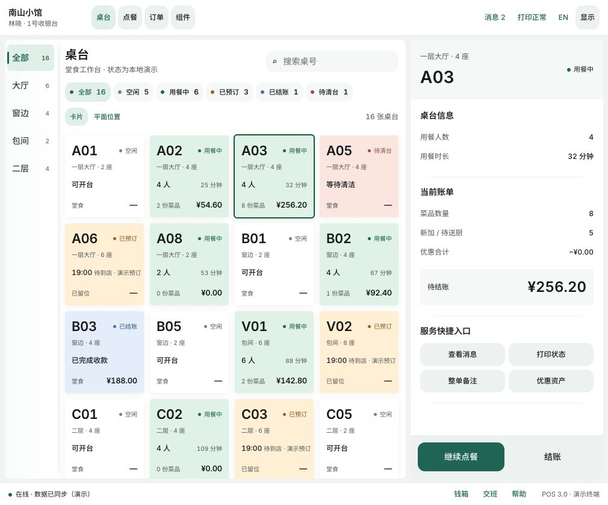
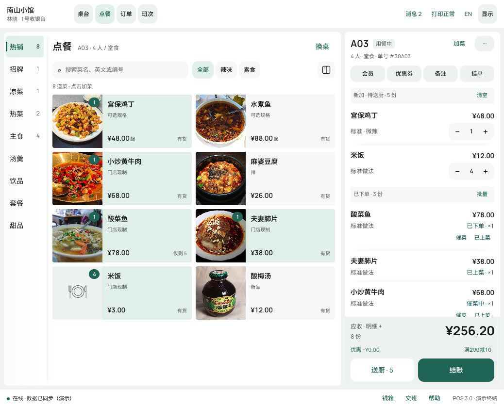
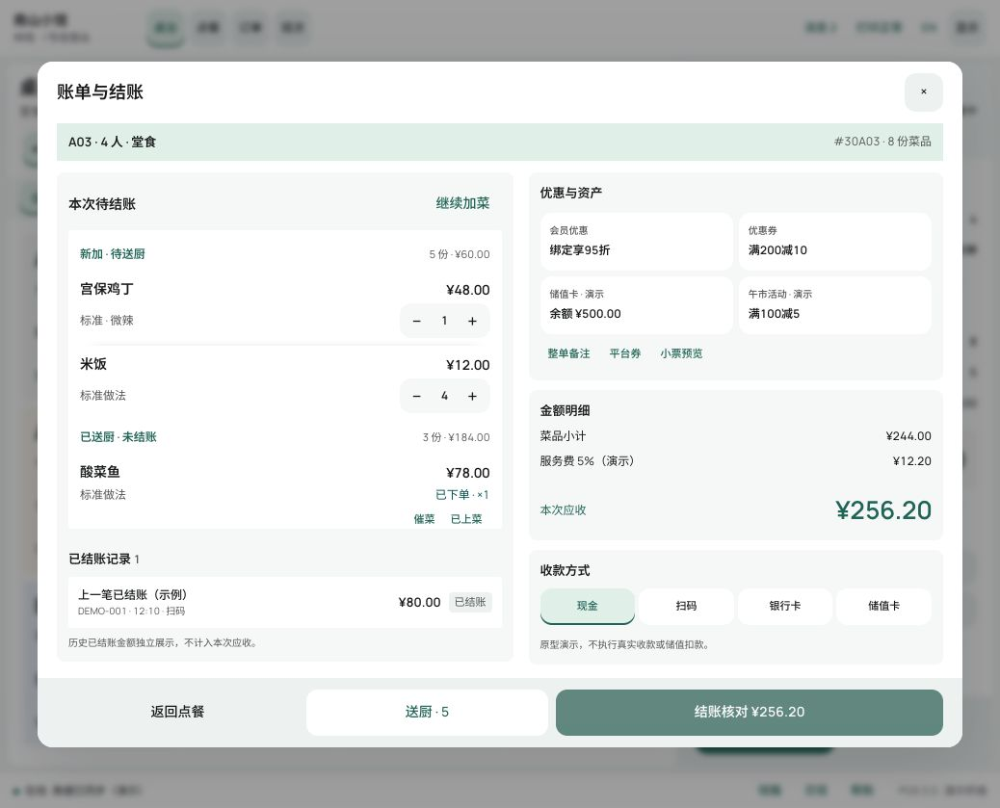
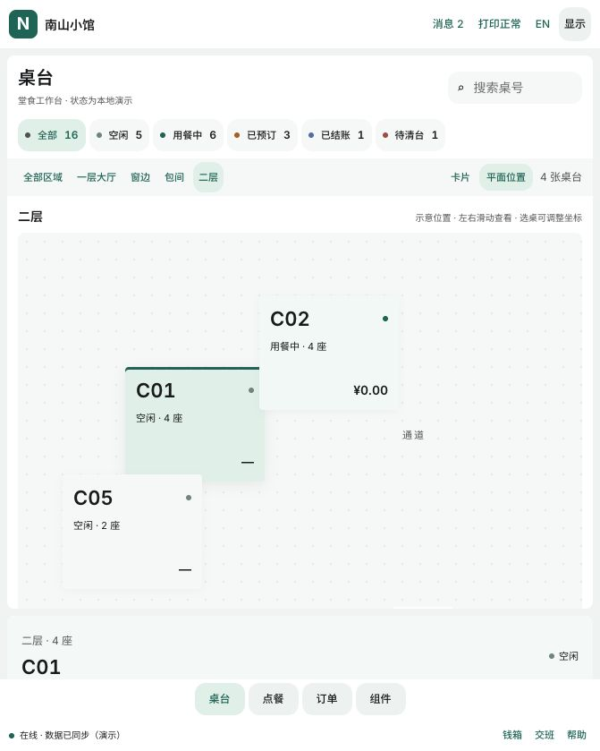
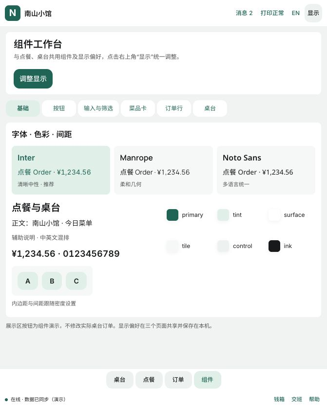

# 餐饮 POS 原型与 UI 开发基线 v3.1

> Android 页面开发请从 [架构与交接索引](android/README.md) 开始，包含当前原型到 Compose 的映射、数据契约和逐页验收清单。

> 基础组件的独立规范见 [组件设计规范 v3.5](餐饮POS组件设计规范-v3.5.md)，按钮、字体、色系、间距、形状及组件复用以该规范为补充基线。

> 最新管理导航与商品表单规则见 [系统管理与商品编辑规范v3.3](餐饮POS系统管理与商品编辑规范-v3.3.md)。系统管理入口、多级菜单和商品餐牌关联以该补充为准。

整理日期：2026-11-02。适用对象：产品、设计、Android 与前端开发、测试。

餐饮 POS 后续开发以当前 v3 HTML 原型的紧凑风格为视觉基线，采用同一套基础令牌、公共组件和业务状态表达。本文固化本轮已经收敛的页面结构与交互，作为开发交接和验收入口。原型演示数据、模拟成功提示和历史 CSS 覆盖方式不作为生产实现要求。

> 2026-11-03补充：[账号与门店管理原型v3.2](餐饮POS账号与门店管理原型补充-v3.2.md) 已增加登录注册、选店与配置页面。本文视觉基线继续适用，新增功能范围以补充文档为准。

## 1 交付入口与版本优先级

| 入口 | 用途 |
| --- | --- |
| [桌台工作台](http://127.0.0.1:8765/v3/pos-ui.html#tables) | 区域分类、桌台状态、开台、账单详情、平面位置 |
| [点餐工作台](http://127.0.0.1:8765/v3/pos-ui.html#order) | 菜单、规格、购物车、送厨、结账核对 |
| [公共组件展示](http://127.0.0.1:8765/v3/components.html) | 基础、字体对照、按钮、筛选、菜品卡、订单行、桌台组件 |
| [原型运行说明](../prototypes/v3/README.md) | 启动方式、代码职责、验证命令 |
| [公共组件说明](../prototypes/v3/components/README.md) | 当前组件接口与复用约定 |

页面地址为本机预览地址，需先启动原型服务。仓库根目录运行：

```sh
python3 -m http.server 8765 --bind 127.0.0.1 --directory prototypes
```

**冲突处理顺序：用户后续确认的变更 → 本文 → 当前 v3 公共组件与默认原型 → 历史方案。** v1.0、v1.5、v2.0、早期 v3.0 提案保留作业务与设计演进参考。历史文档中的大留白、列表模式、顶部桌台色条、所有桌台一律白底等规则已被本基线替代。业务权限、支付与促销规则需单独确认，不由视觉原型推定。

## 2 产品风格与结构

### 2.1 统一视觉方向

采用紧凑、扁平、清晰分区的餐饮工作台。浅色画布承托白色内容区；信息通过字号、字重、留白和浅色填充分层。主操作突出，辅助操作保持安静。减少大面积灰色填充，不使用常规灰色描边框。

- 分类与内容属于同一大区域；用轻渐变、柔和阴影区分逻辑，避免宽缝切断关联。
- 普通按钮采用浅底，选中采用主题浅底与主题文字，主操作采用主题实底与白字。
- 按钮选中态不出现底部阴影、底线或额外立体效果。
- 桌台状态通过整张卡片的背景色表达，不使用顶部状态色条。
- 菜品名称、金额和数量保持稳定对齐；不依靠放大全部字体突出重点。
- 容器与按钮的圆角分别设置，不能用一个圆角值覆盖所有组件。

### 2.2 页面骨架

桌台、点餐、组件展示共用页头、页脚、显示设置与主题。桌面页头包含门店、操作员、终端、工作台导航、消息、打印状态、语言和显示设置。页脚包含联网/同步状态、钱箱、交班、帮助及终端说明。

主工作区独立滚动，页头、页脚和主要操作不随内容滚走。窄窗口改为顶部横向分类与底部工作台导航；点餐购物车通过底部摘要展开。桌台详情在窄屏排列到主内容下方，选桌后定位到详情。

## 3 基础设计令牌

以下是标准字号、紧凑密度、Quiet 风格下的当前视觉参考值。HTML 使用 CSS px；Android 以 dp 表示布局、sp 表示字号，需按目标设备与系统字体缩放校准，不能直接复制物理像素。

### 3.1 色彩

| 角色 | 默认值 | 用途 |
| --- | --- | --- |
| 主色 | `#306F5F` | 主操作、活动分类、强调信息 |
| 主色深阶 | `#215749` | 主操作反馈 |
| 主题浅底 | `#E5F1EB` | 已选按钮、分类与轻强调 |
| 页面画布 | `#F3F5F4` | 内容区外围 |
| 内容表面 | `#FFFFFF` | 主要面板、浮层 |
| 轻填充 | `#F7F9F8` | 普通菜品卡、轻量信息组 |
| 操作区底色 | `#F0F4F2` | 账单底部、普通控件 |
| 正文 | `#181A1C` | 名称、金额、主要文本 |
| 辅助文字 | `#5C5E61` | 时间、规格、次要说明 |
| 危险 | `#B70F0F` | 删除与异常提示 |

皮肤仅替换主题角色，不改变业务状态含义。皮肤有松绿、墨黑、红、蓝、绿、青碧、琥珀、紫；业务状态不能跟随皮肤全部变为同一种颜色。

### 3.2 字体与排版

默认延续原型的 **Manrope + Noto Sans SC**。Inter 作为组件页推荐的清晰中性备选，尚未替换默认值。支持 Roboto、Noto Sans、IBM Plex Sans，以及 Outfit 标题配 Inter 正文。中文统一以 Noto Sans SC/系统中文字体回退，不能把更换英文字体当成中文字体也已变化。

| 文字角色 | 标准字号参考 | 字重与排版 |
| --- | --- | --- |
| 页面标题 | 20 | 600，行高约 1.3 |
| 面板标题 | 18 | 600 |
| 菜名、订单正文 | 14 | 菜名 600、正文 400，行高约 1.45–1.5 |
| 普通按钮 | 14 | 500 |
| 规格、次要说明 | 12 | 400 |
| 桌号 | 21–22 | 600，优先于状态与时间 |
| 桌台状态、区域、时间 | 10–12 | 次级信息，保持层级 |
| 桌台金额 | 13–14 | 600，右侧对齐 |
| 账单应收金额 | 26 | 600–700，突出但不挤占清单 |

大字/特大档当前正文分别为 18/20，标题约 30/34。开发应使用角色令牌统一放大，避免局部固定字号导致混乱。金额使用等宽数字和统一小数位；名称允许换行，金额与数量不换行。中英文切换后不改变用户输入的备注原文。

Android 应将字体作为应用资源管理并保留系统回退；浏览器原型目前从 Google Fonts 在线加载，字体可用性和素材授权需在正式资源交付中核对。

### 3.3 间距、形状与阴影

| 项目 | 默认参考 |
| --- | --- |
| 紧凑布局间距 / 面板内边距 | 8 / 12 |
| 标准间距 / 内边距 | 20 / 20 |
| 舒展间距 / 内边距 | 24 / 24 |
| 普通组件内部节奏 | 4、6、8、12；按角色使用 |
| 内容面板 / 菜品卡 / 按钮圆角 | 8 / 4 / 12 |
| 分类栏宽度 | 约 88，按字号和窗口调整 |
| 账单宽度 | 约 350；较窄桌面约 320 |
| 桌台卡片 | 常规高度 136；宽度随网格，最小参考 124 |
| 平面桌台卡片 | 140 × 112 |
| 普通桌台阴影 | `0 2px 10px #18221E0C, 0 1px 3px #18221E06` |

间距档位控制页面密度；图标、数字和文字保持共同基线。当前原型部分次级控件视觉高度为 32–40，主要操作为 48。**正式 Android 触控命中区域至少按 48dp 落实**，可以使用额外命中留白；不能为追求紧凑而直接缩小触控范围。小字号、对比度与实际观看距离需做真机验收，原型截图不替代可用性检查。

## 4 公共组件与复用规则

| 组件 | 主要状态与契约 | 复用位置 |
| --- | --- | --- |
| 页头、页脚 | 身份、入口、在线/离线、消息、打印反馈 | 三个工作台 |
| 按钮、图标按钮 | 默认、主操作、选中、禁用、危险、键盘焦点 | 全部页面与浮层 |
| 搜索框 | 文字输入、清空、中文输入法组合输入 | 点餐、桌台、组件页 |
| 筛选按钮组 | 单选、计数、选中反馈 | 菜品与桌台筛选 |
| 分类栏 | 长文字换行、固定计数、区块内滚动 | 菜单分类、桌台区域 |
| 菜品卡 | 有图/无图 × 上下/左右，已选数量、可售/沽清/限时 | 点餐与组件展示 |
| 数量步进器 | 增减、边界、不可编辑状态 | 购物车、结账、展示 |
| 订单行 | 新加、排队、已送厨、催菜中、已上菜 | 购物车与结账 |
| 桌台卡 | 五种状态、选中、区域、人数、时间、金额 | 卡片、平面视图、展示 |
| 金额与优惠摘要 | 小计、费用、各项优惠、应收、拟抵扣 | 购物车、结账 |
| 弹窗与侧栏 | 标题、关闭、滚动内容、固定操作、焦点返回 | 规格、备注、开台、设置 |

组件负责渲染与事件输出，业务动作由状态层处理。业务页和组件展示必须调用同一组件，不能单独写一份外观相近的展示样例。基础状态、主题、字体与间距只在公共层维护。

组件页采用基础、按钮、输入与筛选、菜品卡、订单行、桌台分区，一次展示一个分区。字体用同文案与同金额并排对照；菜品卡变体集中比较，避免松散地整页堆叠。展示区业务动作不改变当前桌台订单。

## 5 点餐工作台

### 5.1 区域与工具栏

默认左分类、中间菜单、右购物车。分类与菜单处于同一面板，保留浅渐变与柔和分隔阴影。分类内容必须受自身区块约束：长文字换行，计数不被挤出；超高纵向滚动，顶部/底部分类横向滚动，不能撑开全页。

标题行显示点餐、桌号、人数、堂食及换桌。下一行依次放搜索框、全部/辣味/素食筛选、单个排列切换图标；三者始终属于同一工具栏。搜索宽度桌面上限约 280，不独占整行。排列切换占用一个位置，图标表示当前排列，提示说明点击后的切换方向。

菜品仅保留卡片呈现，支持有图/无图与上下/左右组合，图片比例 3:2 或 1:1。旧文字模式、列表模式及独立反向排列选项不再暴露。

### 5.2 购物车与操作

购物车顶部保留桌号、状态、人数与单号，附会员、优惠券、备注、挂单入口；压缩顶部和底部，将主体高度留给清单。新加待送厨与已下单分组展示，金额右对齐，规格和备注位于次级行。

主操作区固定，送厨与结账宽度约 1:1.2，视觉高度 48。送厨为辅助浅底，结账为主题实底；不出现送厨横占整区、结账被压缩成小按钮的情况。

- 同一菜品、单价、规格、备注相同的新加行可以合并；已送厨与新加分别成行。
- 仅新加行允许直接增减，减到零删除草稿行；库存不足时阻止增加并说明原因。
- 有规格的菜品先确认规格与备注，再加入购物车；取消不改变订单。
- 清空只清未送厨草稿，保留已送厨与排队记录，并二次确认。
- 送厨失败/离线保持待发送身份；不能仅因本地保存就显示已送达厨房。
- 已上菜不能退回催菜；未送厨菜品不能直接切为已上菜。
- 切换桌台、语言或显示设置不清空当前会话账单；每桌数据相互隔离。

## 6 桌台工作台

### 6.1 区域、卡片与筛选

桌台区域分类采用与菜单分类一致的左侧导航。当前示例包括全部、大厅、窗边、包间、二层；正式数据由门店区域配置提供，不硬编码区域数量和桌数。窄屏采用横向分类。

内容区依次为标题/桌号搜索、状态筛选、卡片/平面切换、桌台内容。区域、状态和桌号搜索组合生效。切换区域时，详情默认选中该区域的桌台，避免左侧显示二层而右侧仍指向大厅。

桌台卡片紧凑且等高：桌号最大，状态较小；区域/座位其次；中间显示人数与时间或预订信息；底部显示菜品数量和金额。白色空闲卡外围使用淡灰阴影；其余状态以浅背景区分。

| 状态 | 背景色 | 状态文字色 | 行为 |
| --- | --- | --- | --- |
| 空闲 idle | `#FFFFFF` | `#52635C` | 开台并输入人数 |
| 用餐中 dining | `#E5F3EB` | `#216548` | 继续点餐、核对结账 |
| 已预订 reserved | `#FFF2D9` | `#8A5A14` | 到店开台 |
| 已结账 paid | `#E8EFFB` | `#3A5E98` | 进入清台 |
| 待清台 cleaning | `#F9E8E3` | `#995546` | 清台完成转空闲 |

所有状态不使用顶部色条。选中使用同状态背景、细轮廓与轻阴影，不改变该桌业务状态含义。颜色之外保留状态文字，避免只能靠颜色判断。

右侧详情展示区域与桌号、人数/时长、当前菜量、新加待送厨数量、优惠、应收及服务入口。空闲/预订桌输入有效人数后进入点餐；清台流程不得清除未结订单。

### 6.2 平面位置

卡片与平面视图共用桌台状态、账单与选中对象。每个区域使用独立坐标；筛选改变可见对象，不重排桌台的平面位置。

当前原型采用 900 × 460 示意画布，桌台位置可编辑 X/Y 并保存本机。坐标校验范围为 X 0–744、Y 0–332；该范围是保守兼容早期桌台尺寸的原型边界，正式实现应根据当前节点宽高自动计算。窄窗口支持图内横向滚动。

正式开发需由门店配置实际区域与桌位，不把现有入口、通道或示例坐标当成真实门店数据。位置应采用区域内坐标或归一化坐标，与业务状态分离，并保存到门店配置层。拖拽、旋转、缩放、墙体与平面图上传属于扩展能力，当前未实现。

## 7 账单与结账核对

结账分为明确的两列信息区；窄屏改为上下排列。

| 区域 | 内容 |
| --- | --- |
| 本次待结账 | 新加待送厨、已送厨未结账；组内数量、金额、规格与数量操作 |
| 已结账记录 | 单独列出历史账单号、时间、方式、金额，避免重复抵扣 |
| 优惠与资产 | 会员、优惠券、储值卡余额、活动；显示已选和门槛状态 |
| 金额明细 | 菜品小计、费用、逐项优惠、本次应收 |
| 收款方式 | 现金、扫码、银行卡、储值卡；选择反馈统一 |
| 固定底部 | 返回点餐、送厨、较宽的结账核对主按钮 |

有新加或排队菜品时，原型要求先送厨，结账核对按钮禁用；送厨成功后可核对。优惠变化、增减菜和储值方式选择立即刷新金额。储值拟抵扣与其他方式剩余应付分开显示。

**当前金额仅用于演示**：服务费 5%、会员优惠 5%、满 200 减 10、午市满 100 减 5，示例允许叠加。储值余额示例为 500 元；A03 的历史已付 80 元独立显示，不重复从当前应收减去。原型结账核对不扣款、不扣储值、不自动关单。

正式接入前必须确认费用基数、优惠叠加/互斥、金额舍入、部分支付、储值余额不足处理、退款与已结账加菜规则。支付金额必须由可信业务层核算；金额以最小货币单位存储，不能使用界面浮点数直接结算。支付成功、失败、处理中、超时查询及重复回调均需独立状态。

## 8 显示设置与默认预设

| 设置 | 选项与默认 |
| --- | --- |
| 皮肤 | 8 套；默认松绿 |
| 组件风格 | Quiet、原版适配、Apple 启发、Material 启发、Uber 启发、白玻璃；默认 Quiet |
| 容器形状 | 直角/微圆/轻圆/柔圆；默认轻圆 |
| 按钮形状 | 直角/微圆/轻圆/柔圆/胶囊；默认柔圆 |
| 间距 | 紧凑/标准/舒展；默认紧凑 |
| 字体 | 6 组；默认 Manrope，组件页提供 Inter 推荐对照 |
| 字号 | 标准/大字/特大；默认标准 |
| 语言与菜名 | 中文/英文，单语/双语；默认中文单语 |
| 图片 | 有图/无图、上下/左右、3:2/1:1；默认有图上下 3:2 |
| 导航、账单操作 | 顶部/底部；默认顶部导航、底部操作 |
| 点餐布局 | L1–L6，见下表 |

| 布局 | 分类 | 账单 |
| --- | --- | --- |
| L1 默认 | 左 | 右 |
| L2 | 上 | 右 |
| L3 | 上 | 左 |
| L4 | 右 | 左 |
| L5 | 下 | 右 |
| L6 | 下 | 左 |

L1–L6 当前实现于点餐页；桌台默认左侧区域栏与右详情，不能把表中的所有布局描述为已在桌台实现。风格、字体、皮肤和间距三页共享，业务组件展示不能另用一套主题。

显示设置为非模态侧栏，分组按钮直接选择，即时生效并保存。每个字段只出现一次；容器与按钮形状名称明确区分。无意义的重复选项不保留。历史四方向偏好加载时归一化为上下/左右。

当前本机键：`pos-v3-settings`、`pos-v3-table-positions`。显示偏好和位置可以跨标签页保存，**订单数据仍是页面会话级，刷新恢复示例**；正式 POS 必须补齐订单持久化、崩溃恢复与跨终端一致性。

## 9 开发落地与数据边界

### 9.1 工程分层

基础令牌 → 通用组件 → 餐饮组件 → 页面装配。业务状态、金额计算、持久化与外设服务独立于页面渲染。Android 可沿用既有方案中的 Kotlin/Compose 骨架，将令牌映射为主题对象，将桌台、菜品卡、订单行等映射为公共组件；本文不表示 Android 工程已经完成或真机通过。

| 当前实现 | 开发参考职责 |
| --- | --- |
| `tokens/theme.css` + `ui.css` 的最终生效值 | 颜色、字号、形状、密度令牌 |
| `components/controls.mjs`、`controls.css` | 按钮、搜索、筛选、排列切换 |
| `components/chrome.mjs` | 页头与页脚 |
| `components/ui.mjs` | 菜品卡、订单行、名称与金额输出 |
| `components/gallery.mjs`、`gallery.css` | 组件评审工作台及样例排列 |
| `settings/options.mjs` | 单一设置字段与双语标签定义 |
| `model.mjs` | 订单状态、金额示例、设置校验 |
| `workbenches/order.mjs`、`tables.mjs` | 页面装配与业务交互 |

当前 CSS 有多轮迭代覆盖，不能直接把覆盖链翻译成正式样式架构。实现时应抽取最终值并收敛单一来源；原型 gallery 的样例排列 CSS 不用于覆盖业务组件行为。

### 9.2 实现范围

| 层级 | 已有内容 / 待建设 |
| --- | --- |
| 当前可评审 | 点餐、桌台、组件页、共享设置、规格/备注/数量、模拟送厨、账单核对、平面位置 |
| 当前模拟 | 联网/同步、消息、打印就绪、会员、券、储值、时长、预订、历史收款 |
| 进入真实业务前 | 订单持久化、服务端金额与库存、并发、权限审计、支付与储值、打印回执、异常重试 |
| 后续完整模块 | 订单管理、班次、换桌并桌、拆账、退款、平台券核销、完整预订与外卖业务 |

同桌加菜需要保留既有送厨批次；离线队列要持久保存并具备幂等标识；桌台状态、制作状态、支付状态分开存储。网络恢复不等于付款成功或打印成功。原型的模拟状态不能替代设备和服务端回执。

## 10 开发顺序与验收

建议顺序：基础令牌与公共组件 → 桌台和点餐视觉 → 订单状态与持久化 → 结账业务 → 外设、权限与异常 → 真机回归。组件页随每次变更同步更新，作为视觉检查入口。

### 10.1 视觉验收

- [ ] 标准预设为紧凑 Quiet；三页的按钮、字体、间距、圆角一致。
- [ ] 分类与内容无大缝断裂，分类长文字和数量不超出区块。
- [ ] 搜索、快捷筛选和单个排列图标同一行。
- [ ] 无常规灰色描边、无按钮选中底部阴影、无桌台顶部状态色条。
- [ ] 五种桌台背景与状态文案一致；切皮肤不改变状态语义。
- [ ] 桌台卡片等高，桌号突出，金额对齐；空闲卡保留白底淡阴影。
- [ ] 菜品有图/无图、上下/左右及中英双语均无文字溢出。
- [ ] 大字/特大档与窄屏无页面横向溢出；平面图滚动限定在画布区域。
- [ ] 应收、送厨、结账操作始终可达；结账按钮不被次级操作挤小。

### 10.2 业务与设备验收

- [ ] 开台人数合法；区域/状态/搜索可组合筛选，选桌与详情一致。
- [ ] 每桌订单隔离；切换外观不丢订单，正式版本重启后可恢复。
- [ ] 新加与已送厨分离，库存限制、规格分行、清空范围正确。
- [ ] 已上菜不会退回催菜；离线不会误显示已送厨。
- [ ] 平面位置修改后恢复，坐标不越界，筛选不改变实际位置。
- [ ] 优惠逐项展示；历史已付、储值抵扣和本次应收不重复扣减。
- [ ] 真实支付、退款、打印和储值均按业务回执更新状态，并验证重复请求。
- [ ] Android 触控命中、字体缩放、旋转、返回键、窗口变化及外设异常通过真机检查。

当前已运行 11 项模型测试，覆盖订单合并、库存、离线重试、金额、设置、布局、制作状态、旧偏好迁移、活动与历史支付隔离、桌台筛选、坐标边界。桌台状态背景已做浏览器样式检查。尚未完成商用支付/外设、Android 真机及完整可访问性验收，不能据此宣称可直接商用。

## 11 视觉参考

以下截图用于说明区域和层级，窗口大小与示例订单可能不同；文字规则和公共组件最终生效样式优先。

### 桌台状态背景与紧凑卡片



### 点餐工具栏与购物车



### 结账分区



### 平面位置示意



### 紧凑组件分区与字体对照


