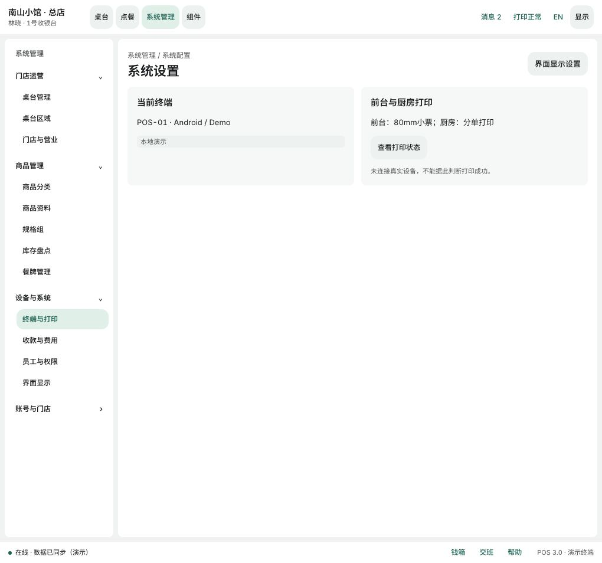
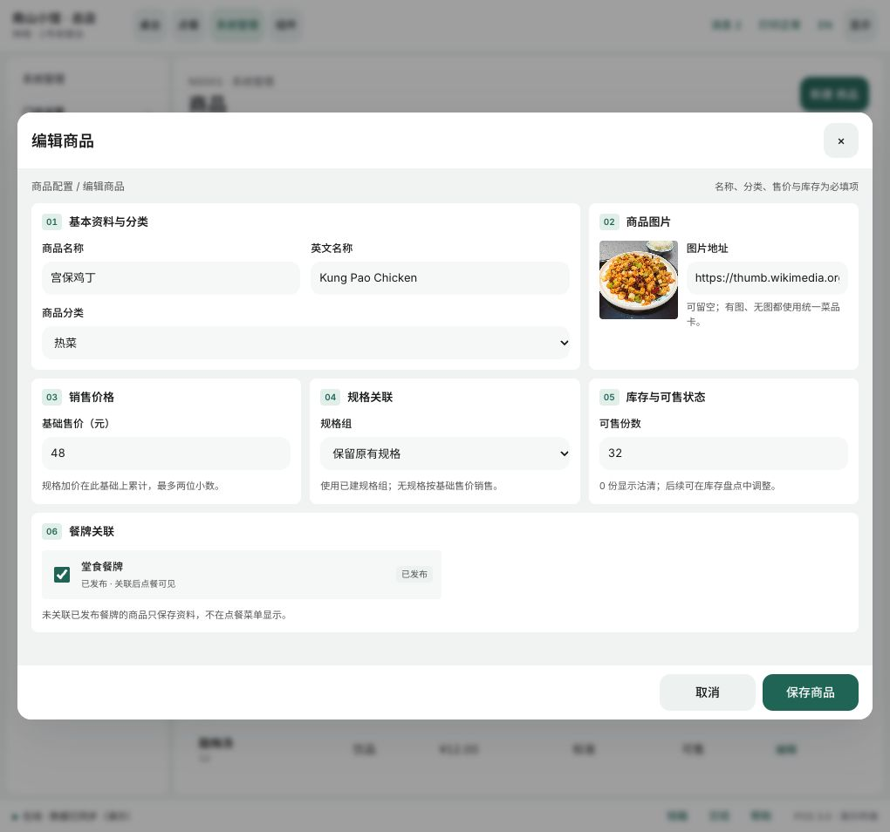

# 餐饮 POS 系统管理与商品编辑规范 v3.3

日期：2026-11-03。承接 [视觉开发基线v3.1](餐饮POS原型与UI开发基线-v3.1.md) 和 [账号与门店管理原型v3.2](餐饮POS账号与门店管理原型补充-v3.2.md)。本次统一系统管理入口、管理导航与商品编辑组件；其余演示边界继续适用。

## 统一入口与多级菜单

全局导航统一使用“系统管理”，入口为 [系统管理工作台](http://127.0.0.1:8765/v3/pos-ui.html#manage)。原 `#system` 保留为系统配置页面入口，两者共用同一棵管理菜单，不再使用两套平级侧栏。

| 一级菜单 | 二级菜单 | 目标 |
| --- | --- | --- |
| 门店运营 | 桌台管理、桌台区域、门店与营业 | 桌台与区域配置、门店信息 |
| 商品管理 | 商品分类、商品资料、规格组、库存盘点、餐牌管理 | 商品数据与销售配置 |
| 设备与系统 | 终端与打印、收款与费用、员工与权限、界面显示 | 设备/系统设置与共用显示侧栏 |
| 账号与门店 | 切换门店、账号登录 | 既有选店和账号流程 |

一级菜单支持展开/收起，二级菜单有选中反馈和当前页语义。选择二级菜单后对应分组保持展开；跨商品列表与系统设置时继续呈现相同导航。窄屏将管理导航放在内容上方，在有限高度内滚动。

## 商品编辑分区

商品列表点击“新建商品”或“编辑”打开共用编辑器。桌面使用宽弹层、浅色工作底与白色分区，取消/保存固定在底部；窄屏改为单列，避免横向溢出。

| 分区 | 字段 | 行为与校验 |
| --- | --- | --- |
| 01 基本资料与分类 | 商品名称、英文名称、分类 | 必填，绑定现有分类；编辑保持原分类 |
| 02 商品图片 | 图片预览、图片地址 | 可留空，编辑地址后预览；失效图片保留占位；当前不支持本地图片上传 |
| 03 销售价格 | 基础售价 | 非负，最多两位小数，上限99999；规格加价另计 |
| 04 规格关联 | 无规格、现有规格组、保留旧规格 | 编辑旧商品不会隐式清除已有规格 |
| 05 库存与可售状态 | 可售份数 | 非负整数，0显示沽清，后续由库存盘点调整 |
| 06 餐牌关联 | 当前门店餐牌复选、发布/草稿状态 | 在商品表单直接维护关联；已发布餐牌立即影响点餐可见性 |

桌面第一行以“基本资料”与“图片”并列，第二行价格/规格/库存并列，餐牌独占一行；较窄窗口逐步折为两列或单列。字段标题、辅助说明、分区编号、输入高度和按钮形状统一使用公共组件风格。保留名称换行和金额稳定对齐。

保存前先校验字段，再更新商品及餐牌关系。取消不写入资料；表单错误留在当前表单显示，不跳页或清空已填内容。图片预览只更新图片区域，不重绘整个表单。

### 餐牌关联规则

- 商品可以关联零个或多个餐牌。零关联时保存为商品资料，不进入点餐菜单。
- 关联已发布餐牌后，商品立即在该门店点餐页可见；草稿餐牌需发布后才可见。
- 编辑时勾选状态回填现有关系。保存替换该商品的关系，不改变其他商品的关系，不重复添加相同商品。
- 解除全部已发布餐牌关联后，商品从点餐菜单隐藏，已有订单行继续保留。
- 餐牌因解除关联而变空时自动停用；空餐牌不可重新发布，需先添加商品。
- 关联操作不自动发布草稿餐牌，不隐式删除商品。

## 组件复用

`components/management.mjs` 提供：

- `managementGroups`：唯一的管理菜单树定义。
- `managementNavigation({L,active,open,preview})`：一级分组、二级链接、展开与选中状态。
- `productEditor({product,categories,specs,menus,L,preview})`：六分区商品表单。

`workbenches/admin.mjs` 负责数据、校验、保存与菜单关联；`components/admin.css` 负责导航和表单配方。组件不直接决定生产权限或远端发布结果。

[组件展示页](http://127.0.0.1:8765/v3/components.html) 增加“管理表单”分区，直接调用同一套菜单和编辑器，展示已发布/草稿关联状态。展示区保存按钮仅为演示，表单回车不会提交或修改工作台数据。

## 验收与验证

- 已验证多级菜单的展开、选中、跨页面定位。
- 已验证创建商品时直接关联已发布餐牌，保存后点餐搜索可见。
- 已验证解除关联后点餐隐藏，商品资料仍在。
- 已验证390px窗口下六分区单列、弹层无横向溢出、底部保存按钮可达。
- 已验证组件展示页使用同一编辑器，显示六个分区。
- 15项模型测试通过，包括新增餐牌关联替换、无重复、其他商品不受影响、空餐牌停用回归。

开发仍需接入配置持久化、真实权限、并发/事务、图片上传和餐牌发布服务。当前数据为页面会话级原型，刷新恢复示例。

## v3.4 后续更新

本地图片上传、多规格组合、SKU 独立价格与库存已在 [v3.4 规范](餐饮POS多规格SKU与商品图片规范-v3.4.md) 实现，覆盖本文原先图片和单规格限制；正式远端上传与库存并发服务仍待接入。
