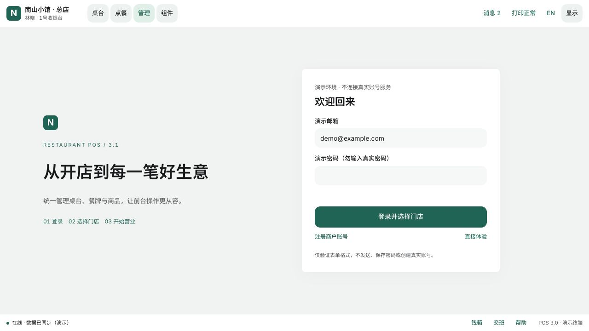
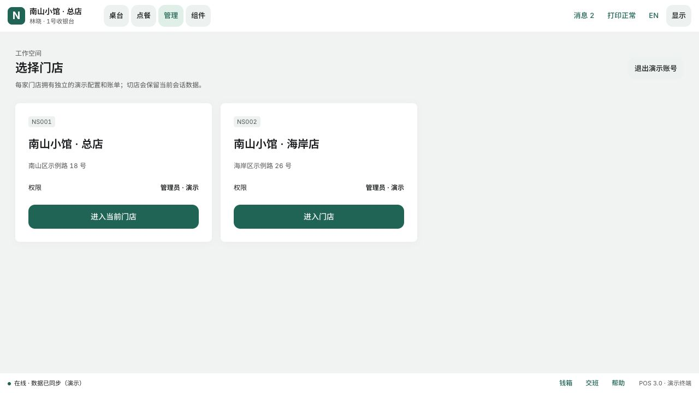
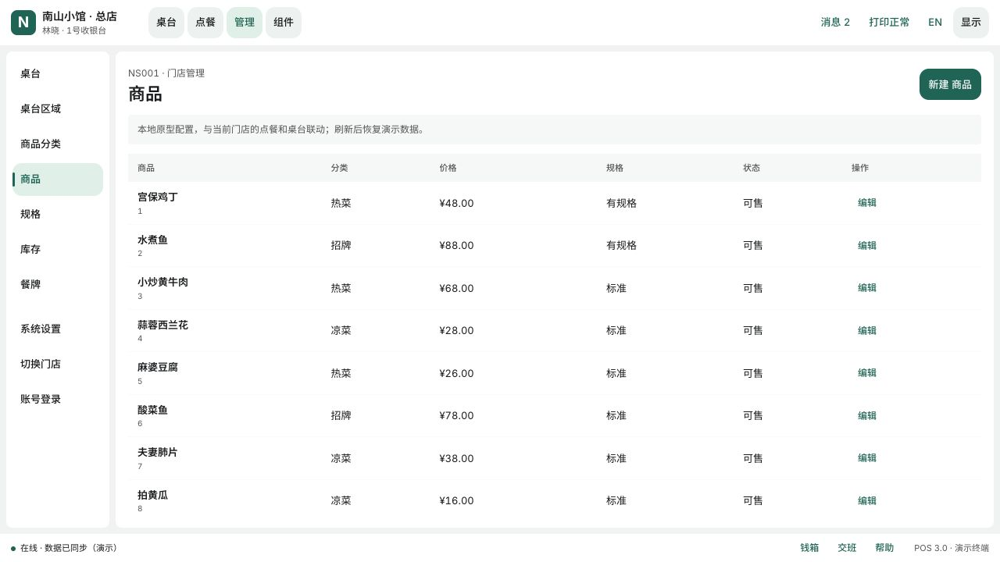
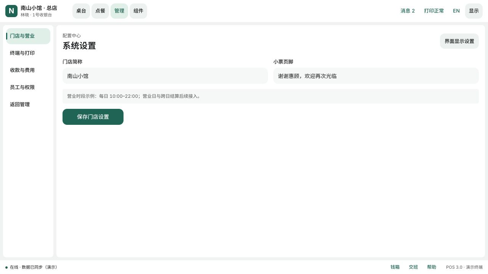

# 餐饮 POS 账号与门店管理原型补充 v3.2

> 最新管理导航与商品表单规则见 [系统管理与商品编辑规范v3.3](餐饮POS系统管理与商品编辑规范-v3.3.md)。系统管理入口、多级菜单和商品餐牌关联以该补充为准。

日期：2026-11-03。沿用 [UI开发基线v3.1](餐饮POS原型与UI开发基线-v3.1.md) 的紧凑布局、浅色填充、公共控件、页头页脚和显示设置。本轮增加可操作的配置原型，不代表生产账号、权限和后台服务已接入。

## 入口与导航

| 页面 | 地址 | 行为 |
| --- | --- | --- |
| 登录 | `/v3/pos-ui.html#login` | 演示邮箱、密码格式校验、注册入口、直接体验 |
| 注册 | `/v3/pos-ui.html#register` | 商户名、邮箱、密码与确认密码；一致性校验后选店 |
| 选择门店 | `/v3/pos-ui.html#stores` | 总店、海岸店两套演示工作空间 |
| 门店管理 | `/v3/pos-ui.html#manage` | 桌台、区域、分类、商品、规格、库存、餐牌 |
| 系统设置 | `/v3/pos-ui.html#system` | 门店营业、终端打印、收款费用、员工权限 |

完整地址前缀为 `http://127.0.0.1:8765`。工作台导航增加“管理”；点击页头门店名称切店，管理侧栏可返回账号登录、选店或系统设置。

## 账号与门店

登录/注册表单检查邮箱格式、密码至少8位，注册还检查两次密码一致。密码不发送、不保存；不会创建真实账号。可用“直接体验”进入选店。

两家门店各自保留本次会话的商品、分类、规格、餐牌、桌台、设置与账单。切店先保存当前内存快照，切回恢复；刷新恢复初始演示数据。门店名称在页头明确显示。原型不强制鉴权和路由拦截，正式版本必须由服务端核验账号、门店授权和操作权限。

## 配置流程

| 模块 | 可操作内容 | 校验与联动 |
| --- | --- | --- |
| 桌台区域 | 新建中英文区域 | 名称必填、同店名称不重复，桌台和区域导航共用数据 |
| 桌台 | 新建桌号、区域、座位数；查看工作台 | 桌号唯一，仅字母数字短横线；座位1–30整数；创建后进入桌台数据与独立空账单 |
| 商品分类 | 新建中英文分类 | 分类名称唯一；商品表单与点餐分类同步 |
| 商品 | 新建/编辑中英文名、分类、售价、库存、规格组、图片URL | 价格非负且最多两位小数，上限99999；库存非负整数；旧商品编辑保留标签、限时和原有规格 |
| 规格 | 新建规格组、英文名、选项与加价 | 格式 `名称:加价,名称:加价`，非负金额最多两位小数；商品绑定后点餐显示该组并计算加价 |
| 库存 | 按商品进行盘点调整，填写原因 | 调整为非负整数；0库存展示沽清并禁止点餐新增 |
| 餐牌 | 创建、选择商品、编辑、发布/停用 | 名称唯一、至少一个商品；点餐只显示属于已发布餐牌的商品；多个已发布餐牌取并集 |

新建商品需加入已发布餐牌才进入点餐菜单。规格原型采用必选单选组；尚不支持多规格笛卡尔组合、SKU独立库存、必选多选、做法与加料组合。库存为本地示例可售上限，不代表跨终端实时余量。

推荐演示顺序：选店 → 创建区域/桌台 → 创建分类 → 创建规格组 → 创建商品并绑定规格 → 创建餐牌并勾选商品 → 发布餐牌 → 点餐搜索商品 → 选规格加菜 → 返回库存盘点。

## 系统设置

- 门店与营业：门店简称、小票页脚可保存到当前会话；简称同步页头，小票页脚进入小票预览。营业时段仅为示例说明。
- 终端与打印：展示终端身份、前台/厨房打印用途，链接既有打印状态弹窗；不发送真实打印任务。
- 收款与费用：展示渠道和当前演示计费规则；不在此原型中修改真实费率或支付凭证。
- 员工与权限：展示收银员、店长、管理员职责，尚不执行生产权限校验。
- 界面显示设置：复用既有侧栏与本机偏好，和系统业务配置分开。

## 实现与验证

新增 `workbenches/admin.mjs` 负责管理数据、表单与演示路由，`components/admin.css` 负责紧凑表格、管理侧栏、登录与门店卡片；继续复用公共按钮、金额格式、页头、页脚、规格弹窗和主题。

原有11项模型测试加3项管理表单测试，共14项通过。新增测试覆盖桌号重复、座位边界、商品双语名称/价格精度/库存、盘点合法值。

浏览器验证：注册后选店、创建桌台/分类/商品/规格、发布餐牌后点餐可见、规格加价、库存归零、切店数据隔离、切回账单恢复、门店简称保存，以及390px宽度下管理表格与弹窗无页面横向溢出。创建桌台表单的 `id` 字段与HTML表单属性同名问题已修复，保存不再触发GET刷新。

## 后续开发

账号服务、邮箱/短信验证、忘记密码、权限控制、配置持久化、数据同步、操作审计、真实库存流水、餐牌营业时段、支付和外设均需后续实施。当前不提供删除业务配置和真实账号创建，避免把本地演示结果误认为后台已完成。

